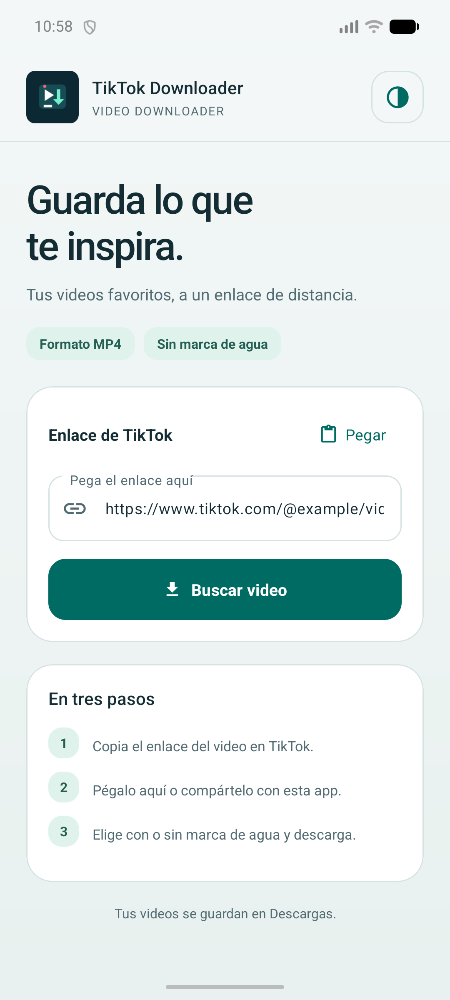
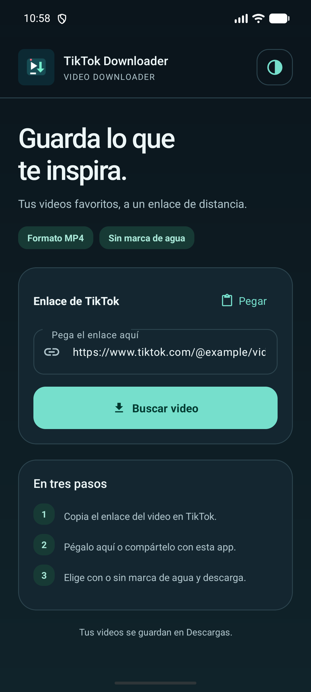
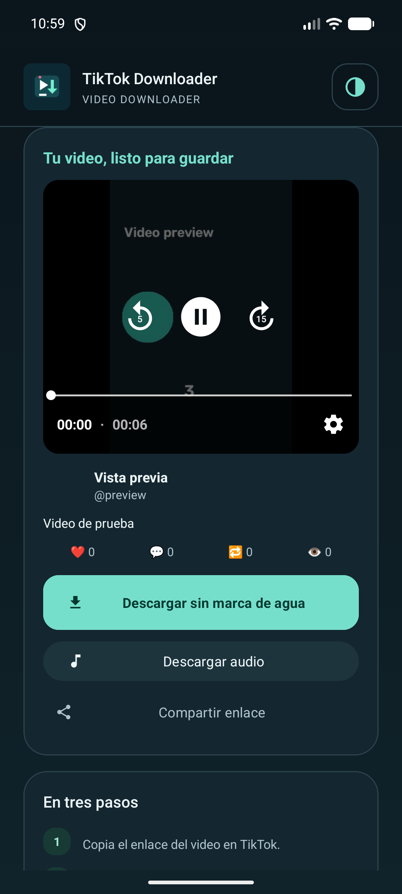

<p align="center">
  
</p>

# TikTok Downloader

Aplicación Android para buscar videos de TikTok, reproducirlos dentro de la app y descargar el video o su audio. Desarrollada en Java, con Material Design 3 y temas claro y oscuro.

## Descargar la aplicación

Descarga el APK de la versión de prueba desde [Releases](https://github.com/IamDiomer/TikTokDownloader/releases). Abre la publicación más reciente y descarga el archivo `.apk` de sus adjuntos.

Requiere **Android 7.0 o superior**. Las versiones preliminares están firmadas con la clave de desarrollo y se ofrecen para pruebas; no son compilaciones de producción para Google Play. Cada publicación incluye un archivo `SHA256SUMS.txt` para comprobar la integridad de la descarga.

## Funciones

- Buscar un video pegando su enlace o compartiéndolo desde TikTok.
- Descargar videos con o sin marca de agua, según los enlaces disponibles.
- Descargar el audio cuando el servicio de búsqueda lo proporciona.
- Reproducir el video con controles de pausa, avance y retroceso.
- Conservar la posición de reproducción al recrear la pantalla.
- Ver el autor, la descripción y las estadísticas del video.
- Mantener la cabecera visible al desplazarse.
- Elegir tema claro, oscuro o según el sistema; la preferencia se guarda.
- Usar el destino **Descargar Video Directo** del menú Compartir para iniciar una descarga rápida.

## Capturas

<p align="center">
  
  
  
</p>

Las capturas muestran el emulador de desarrollo; el reproductor utiliza un video de prueba.

## Uso

1. Copia el enlace de un video en TikTok.
2. Abre la app, pulsa **Pegar** o introduce el enlace y pulsa **Buscar video**.
3. Pulsa **▶** para reproducirlo o elige una opción de descarga.
4. Encuentra los archivos descargados en `Descargas/TikTok_Downloads`.

También puedes seleccionar **TikTok Downloader** desde el menú Compartir de TikTok. El botón **◐** de la cabecera permite cambiar la apariencia.

## Requisitos de desarrollo

- Android Studio compatible con Android Gradle Plugin **9.3.3**.
- JDK **25**, indicado en `gradle/gradle-daemon-jvm.properties`.
- Android SDK con plataforma **API 37**.
- Conexión a Internet para resolver las dependencias y buscar videos.
- Dispositivo o emulador con **Android 7.0 / API 24** o superior.

El proyecto incluye Gradle Wrapper **9.5.0**. El código Java se compila con compatibilidad de lenguaje Java 11; el JDK que ejecuta Gradle es el configurado para su daemon.

## Abrir y compilar

1. Clona este repositorio.
2. Abre su carpeta raíz en Android Studio.
3. Configura la ubicación del SDK desde Android Studio; `local.properties` es un archivo local y no se incluye en Git.
4. Sincroniza Gradle y ejecuta la configuración `app` en un dispositivo o emulador.

En Windows (PowerShell):

```powershell
.\gradlew.bat :app:assembleDebug
```

En macOS o Linux:

```bash
bash ./gradlew :app:assembleDebug
```

El APK de desarrollo se genera en:

```text
app/build/outputs/apk/debug/app-debug.apk
```

Para una distribución de producción, genera y firma una compilación de release desde Android Studio. No subas almacenes de claves ni contraseñas al repositorio.

## Verificación

Pruebas unitarias y análisis estático:

```powershell
.\gradlew.bat :app:testDebugUnitTest :app:lintDebug
```

Pruebas instrumentadas, con un dispositivo o emulador conectado:

```powershell
.\gradlew.bat :app:connectedDebugAndroidTest
```

Las pruebas instrumentadas cubren el cambio de tema y la conservación del enlace, la cabecera fija, reproducción de un archivo local, restauración de la posición pausada, liberación del reproductor, recuperación ante errores y visibilidad de la opción de audio. No sustituyen una prueba con enlaces reales del servicio externo.

## Tecnologías

| Componente | Uso |
| --- | --- |
| Java | Lógica de la aplicación |
| Material Components / AppCompat | Interfaz y temas |
| AndroidX Media3 / ExoPlayer | Reproducción del video |
| OkHttp | Consultas de información del video |
| Glide | Carga de portadas y avatares |
| Android DownloadManager | Descargas y notificaciones del sistema |
| JUnit / AndroidX Test / Espresso | Pruebas |

## Estructura

```text
app/src/main/java/com/udh/tiktokdownloader/
├── DownloaderApplication.java   # Preferencia de apariencia
├── MainActivity.java            # Búsqueda, vista previa y reproducción
├── QuickDownloadActivity.java   # Descarga desde el menú Compartir
├── TikTokParser.java            # Consulta y lectura de los datos del video
├── TikTokVideoInfo.java         # Modelo del video
└── DownloadHelper.java          # Descargas de video y audio
```

Los recursos de interfaz están en `app/src/main/res`; las pruebas se encuentran en `app/src/test` y `app/src/androidTest`.

## Servicio externo y disponibilidad

La búsqueda consulta `https://www.tikwm.com/api/` y envía a ese servicio el enlace introducido. El proyecto no necesita una clave de API configurada, pero depende de la disponibilidad y del formato de respuesta de ese servicio. Los enlaces, el audio y las versiones sin marca de agua pueden no estar disponibles para todos los videos. El audio se descarga desde el enlace proporcionado; la app no lo extrae ni lo transcodifica a partir del video.

Esta aplicación es un proyecto independiente y no está afiliada a TikTok. Descarga únicamente contenido que tengas derecho a guardar y utilizar.
